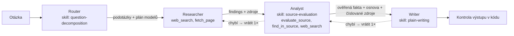

# Research Agents – multi-agentní výzkumný asistent

Uživatel zadá otázku a zpracují ji čtyři agenti s odlišnými rolemi. V UI je vidět, co který právě dělá,
jaké nástroje volá, co si předávají a jak vypadá přesné `messages`, system prompt a tools každého z nich.

**Živá verze:** <https://demo.pavelpytlik.cz> (za přihlášením, údaje posílám zvlášť, v repu nejsou) ·
**Bez API klíče** aplikace běží v mock režimu (stejný tvar odpovědí jako API, orchestrace i tool loop běží naostro).



## Demo za 2 minuty

1. Přihlas se a zeptej se třeba „Jaký je stav zavádění AI ve středních firmách v ČR?“. Sleduj karty: router vybere
   model, Researcher volá `web_search` (WEB v #PRŮBĚH) a `fetch_page` (TLS), handoffy jsou HND a případné vrácení RET.
2. Klikni na kartu **Analyst** → záložka **#TOOLS**: volání `evaluate_source` (skript skillu) a jeho skóre;
   **#SKILL**: celý SKILL.md a kolikrát se skript skutečně vykonal.
3. Klikni na **Writer** → **#HANDOFF IN**: co dostal a jestli prošel kontrakt; **#API VOLÁNÍ**: přesné pole
   `messages` poslané do API. Nad odpovědí jsou počítadla (ověřené citáty, podložená fakta), pod ní důkazy,
   zdroje s tierem A–D, kontrola citací a odhad ceny.
4. Polož doplňující otázku: projde stejnými agenty a navazuje na předchozí odpověď.

## Proč čtyři agenti (a kdy by stačil jeden prompt)

Jeden prompt s web searchem umí odpovědět taky. Rozdělení se vyplatí, když záleží na **důvěryhodnosti**:
každý krok má vlastní úzké zadání a jeho výstup se dá zkontrolovat dřív, než na něm stojí další krok.
Writer nemá nástroje, takže nemůže přidat neověřený fakt; Analyst může práci vrátit. A router drží cenu:
jednoduchá otázka jede celá na nejlevnějším modelu, drahý model dostane jen to, co ho potřebuje.
Pro rychlé faktické otázky by stačil jeden agent; tahle architektura je pro odpovědi, které má někdo použít
k rozhodnutí.

## Jak to splňuje zadání

| Požadavek | Kde |
|---|---|
| 3–4 subagenti s odlišnými rolemi | `app/agents.py`, system prompty v `prompts/*.md` |
| UI ukazuje práci každého agenta, ne jen shrnutí | karty agentů, živý průběh, inspektor (klik na kartu); vzhled DESKY: monospace, 1px linky, barva jen pro stav, světlý/tmavý motiv |
| Claude API voláno napřímo, bez LangChainu | `app/llm.py` – `httpx` POST na `/v1/messages`, vlastní tool loop |
| Viditelná práce s messages, system prompt a tools | inspektor: záložky **#SYSTEM**, **#API VOLÁNÍ** (přesné pole `messages`), **#KONVERZACE**, **#TOOLS** |
| Vlastní Skill se SKILL.md, reálně použitý | `skills/source-evaluation` (Analyst, i jako tool `evaluate_source`), `skills/plain-writing` (Writer), `skills/question-decomposition` (Router) |
| Jasný handoff mezi agenty | `app/orchestrator.py` + kontrakty v `app/contracts.py`, v UI události HND a RET v #PRŮBĚH |
| Agent s nástrojem, který opravdu volá | Researcher: `web_search` (server tool Anthropic) + `fetch_page` (náš klient); Analyst: `evaluate_source` + `find_in_source` + `web_search` |
| Orchestrace explicitně v kódu | sekvenční pipeline v `Pipeline.run()`, žádné předávání uvnitř jednoho promptu |

## Orchestrace a handoffy

`app/orchestrator.py` je jediné místo, které posouvá data mezi agenty. Agenti spolu nemluví napřímo.

1. **Router** (vždy nejlevnější model) určí náročnost `simple | moderate | complex`, cíl a 2–5 podotázek.
   Podle náročnosti **kód** (tabulka `MODEL_PLAN` v `app/agents.py`) vybere model, rozpočet vyhledávání
   a limit zjištění pro další agenty:

   | náročnost | Researcher | Analyst | Writer | web_search | zjištění |
   |---|---|---|---|---|---|
   | simple | Haiku | Haiku | Haiku | 2 | max. 6 |
   | moderate | Sonnet | Sonnet | Sonnet | 5 | max. 12 |
   | complex | Sonnet | Opus | Opus | 8 | bez limitu |

2. **Researcher** hledá (`web_search`), čte stránky (`fetch_page`) a vrací `findings` se zdroji.
3. **Analyst** ohodnotí každý zdroj skillem `source-evaluation`, ověří klíčová tvrzení a připraví osnovu.
   Když citát nestačí, prohledá plný text zdroje přes `find_in_source`.
4. **Writer** napíše odpověď skillem `plain-writing` a cituje číslované zdroje `[n]`.
5. **Kontrola výstupu** v kódu: každá citace míří na existující zdroj, delší odstavce s tvrzeními mají citaci
   (sekce „Co nevíme“ a „Co dál“ žádná tvrzení nenesou), je tam sekce „Co nevíme“.

Každý handoff má dvě kontroly:

- **kontrakt v kódu** (`app/contracts.py`), např. Researcher musí dodat ≥ 3 zjištění a ≥ 2 různé zdroje,
- **kontrolu přijímajícího agenta**: Analyst i Writer vracejí `handoff_check: {ok, missing}`.

Když jedna z nich neprojde, orchestrátor vrátí práci předchozímu agentovi se seznamem, co chybí
a s jeho předchozím výstupem (`MAX_RETURNS`, výchozí 1× na přechod). Každý pokus má jeden auditovatelný
záznam `validation_result` (kontrakt v kódu + kontrola příjemcem + rozhodnutí `retry | continue |
continue_partial | abort`), v UI v záložce **#VALIDACE**.

### Konečné stavy běhu (nic se netváří jako hotové)

| Stav | Kdy |
|---|---|
| `COMPLETED` | všechny handoffy prošly a platí níže uvedené invarianty |
| `PARTIAL` | odpověď existuje, ale něco neprošlo: kontrakt po vyčerpání vrácení, selhané vrácení nebo závěrečná kontrola; v UI jsou vypsané důvody |
| `INSUFFICIENT_EVIDENCE` | žádné podložené zjištění/fakt: běh se zastaví, Writer se nevolá, odpověď poctivě řekne, co chybí |
| `FAILED` | technická chyba (API, nedokončený tah, refusal); odlišené od nedostatku důkazů |

`COMPLETED` v kódu znamená, že platí všechno z tohoto seznamu:

1. Každý fakt, který Writer použil, má stav `SUPPORTED` nebo `PARTIALLY_SUPPORTED` a aspoň jeden citát, který kód našel ve stažené stránce.
2. Každé `[n]` patří zdroji s takovým ověřeným citátem u některého použitého faktu.
3. Každá věta, odrážka a řádek tabulky s číslem má vlastní `[n]`, kromě sekcí „Co nevíme“ a „Co dál“.
4. Tier a skóre zdroje spočítal kód z výsledku nástroje a omezené úpravy Analysta.

`COMPLETED` nezaručuje, že citát významově podporuje tvrzení: to je úsudek Analysta. `PARTIALLY_SUPPORTED`
stačí, protože Analyst musí tvrzení zúžit tak, aby ho citát pokryl celé. Ani bod 3 neváže větu ke konkrétnímu
faktu, kontroluje jen přítomnost citace.

`max_tokens`, `refusal`, neznámý `stop_reason` ani vyčerpané `max_turns` se nikdy neberou jako hotový
výstup. Tah uříznutý na `max_tokens` (`MAX_TOKENS`, do limitu se počítá i thinking) se zahodí a spustí
znovu s `MAX_TOKENS_RETRY`; neplatný JSON dostane jeden opravný tah. Jinak běh končí `FAILED`, ale
selhání při **vrácení** už hotovou práci neruší: předchozí výsledek zůstává a běh pokračuje jako `PARTIAL`.
Vrácený Researcher posílá jen nová a opravená zjištění, kód je sloučí podle `id`.

Agenti s tool smyčkou (Researcher, Analyst) používají prompt caching (`cache_control` na úrovni požadavku,
5 min). Router a Writer ne: jednorázový zápis do cache by se nikdy nepřečetl. S cache je `input_tokens` jen
nezacachovaný zbytek, takže UI sčítá všechna pole a cena se počítá z `usage` každé odpovědi zvlášť.

### Doplňující otázky

Po odpovědi se dá ptát dál. `POST /api/jobs` dostane `parent_id` a kontext si server vezme z předchozího
běhu (patří stejné session, prohlížeč ho nedodává). Otázka projde stejnými agenty: Router ji přepíše na
`standalone_question`, Researcher dostane `known_findings` a přes `reuse` si převezme zjištění, která už
existují (citáty se znovu kontrolují proti uloženým stránkám), Writer dostane `earlier_answers`, aby se
neopakoval. Pamatují se poslední 3 otázky a nejvýše 40 zjištění; při restartu serveru se kontext ztratí.
Kdo chce začít znovu, klikne na **Nové téma**.

### Kalibrace podle složitosti

Všichni čtyři agenti běží vždy, liší se množství práce (`MODEL_PLAN` v `app/agents.py`): `simple` má 2
hledání a nejvýše 6 zjištění, `moderate` 5 a 12, `complex` 8 a bez limitu. Analyst u `simple` vrací práci jen
když na podotázku chybí potvrzený citát a Writer u něj píše krátce s nejvýše 2 body v „Co nevíme“.
Zdroje se hodnotí podle `temporal_sensitivity` tvrzení: `timeless` (stáří se nepočítá), `slow-changing`
(staré po 10 letech), `time-sensitive` (staré po 4 letech).

Když citát pokrývá jen část tvrzení, Analyst prohledá plný text zdroje přes `find_in_source` a přidá
`added_findings`; kód je přijme jen pokud citát na stránce opravdu je. `UNSUPPORTED` a `NOT_CHECKED` smí mít
prázdné `based_on`, ve finální odpovědi je nelze použít jako ověřený fakt.

### Evidence ledger (`app/evidence.py`)

Tři úrovně, které se nemíchají: **kvalita zdroje** (prior ze skillu), **podpora tvrzení** (citát podporuje
tvrzení) a **potvrzení více weby** (dva weby tieru B+ s různými citáty). Poslední je heuristika: přepsanou
tiskovou zprávu kód nepozná, proto ji Analyst může vetovat (`same_origin`), ale potvrzení přidat nemůže.

1. Researcher u každého zjištění (`f1…`) dodá doslovný citát; model vidí z každé stránky 6000 znaků, server
   drží až 200 000 znaků pro kontrolu citátů a `find_in_source`.
2. Kód hledá citát v textu (`exact | normalized | not_found | not_in_fetched_part | not_fetched`).
   `quote_verified` znamená jen „citát je v textu, který jsme stáhli“, ne že je pravdivý.
   Když Researcher cituje jen výsledek vyhledávání, kód stránku otevře sám (nejvýš 10, bez tokenů), takže
   citát dostane skutečnou odpověď místo `not_fetched`.
3. Analyst vytvoří fakta (`F1…`) s `based_on` odkazy na zjištění a `verification_status`
   (`SUPPORTED | PARTIALLY_SUPPORTED | CONTRADICTED | UNSUPPORTED | NOT_CHECKED`).
4. Kód z toho sestaví ledger. Fakt bez ověřeného citátu přejde na `NOT_CHECKED` s jistotou `low`, ať
   Analyst napsal cokoli, a citovat lze jen zdroje s ověřeným citátem. `high` vyžaduje dva weby B+ nebo
   primární zdroj, který musí mít tier A. Slovo modelu `primary` samo nestačí.
5. Writer dostane jen podložená fakta, vrací `used_facts` a kód kontroluje, že každé `[n]` v odpovědi
   patří k použitému faktu. V UI panel **#DŮKAZY** ukazuje fakta, citáty a stav CITÁT OK / CITÁT ?.

## Skills

Skill = složka se `SKILL.md` (YAML frontmatter `name`, `description`, `version` + instrukce) a volitelnými skripty.
`app/skills.py` je načte a připojí do system promptu agenta jako `<skill>` blok. Skript skillu je agentovi
vystavený jako nástroj, takže skill se opravdu volá, ne jen „čte“.

- **`source-evaluation`** (Analyst): dvoufázové hodnocení. Nejdřív skript `scripts/score_source.py`
  (přes tool `evaluate_source`) dá deterministické skóre 0–100 a tier A–D podle typu domény, https a stáří.
  Stáří zdroje se počítá podle `temporal_sensitivity` tvrzení. Agent skóre jen navrhuje: `adjust` ve skriptu
  uplatní změnu nejvýš ±15, bez odůvodnění žádnou, a tier spočítá sám, takže úsudek posune zdroj nejvýš o jeden tier.
  Pak podle pravidel přidělí každému faktu jistotu (`high` jen s jedním primárním A zdrojem nebo dvěma
  weby B+). Tier se zobrazuje u zdrojů v odpovědi, skóre nástroje i úprava jsou v popisku.
- **`plain-writing`** (Writer): odpověď nejdřív, krátké věty, čísla s jednotkou a datem, citace u každého
  faktu včetně tabulek, oddělení faktů od odhadů, povinná sekce „Co nevíme“, zakázané vatové fráze, délka a míra
  nejistot podle náročnosti.
- **`question-decomposition`** (Router): jak se ptá konzultant, než odpoví: jaké rozhodnutí uživatel dělá,
  co se dá změřit, jaké podotázky pokrýt.

Skript lze pustit i ručně: `python skills/source-evaluation/scripts/score_source.py https://www.czso.cz "2026"`.

## Viditelnost messages, system promptu a tools

Klikni na kartu agenta. Inspektor ukazuje:

- **#SYSTEM**: role + připojené skills, přesně jak šly do API,
- **#API VOLÁNÍ**: každý POST zvlášť (Request N / Response N) se snímkem `messages` v okamžiku odeslání,
  `stop_reason`, tokeny a délkou; zobrazená verze je redigovaná (bez `encrypted_content`),
- **#KONVERZACE**: pole `messages` po doběhnutí agenta,
- **#VALIDACE**: záznamy o předáních, kde agent byl odesílatel nebo příjemce,
- **#TOOLS**: JSON definice nástrojů a každé volání se vstupem a výsledkem,
- **#VÝSTUP** a **#HANDOFF IN**: co agent vrátil a co dostal, včetně výsledku kontraktu,
- **#SKILL**: celý SKILL.md a skutečné vykonání (`skill_loaded` = načteno do promptu, `skill_result` =
  kolikrát se zavolal `evaluate_source` a pokrytí zdrojů; nepokrytý zdroj je chyba kontraktu).

Každý běh se loguje do `logs/<run_id>.jsonl` (retence `LOG_RETENTION_DAYS`, výchozí 7 dní) a trace je
v UI ke stažení jen pro session, která běh spustila.

## Spuštění

```bash
python -m venv .venv && . .venv/bin/activate
pip install -r requirements.txt
cp .env.example .env            # bez ANTHROPIC_API_KEY běží mock režim
set -a; . ./.env; set +a
uvicorn app.main:app --reload --port 8000
# http://localhost:8000
pytest -q                       # 74 testů, běží offline (mock + scénáře T01–T18)
```

Nasazení je v příloze na konci.

## Bezpečnost a náklady

- Klíč jen v prostředí (`.env` / `/etc/research-agents.env`), nikdy v repu.
- S `LOGIN_USER_SHA256` a `LOGIN_PASS_SHA256` je celá aplikace za přihlašovací obrazovkou: bez session odpovídá
  jen `/login` a `/static`. Server drží pouze SHA-256 hashe, po 10 chybných pokusech z IP se přihlášení na 15 minut
  zablokuje. Údaje jdou jen v těle `POST /api/session` → `HttpOnly`, `SameSite=Lax` cookie (Secure na HTTPS).
  Otázka jde v těle `POST /api/jobs`; URL streamu nese jen id jobu. Trace i události vidí jen session,
  která běh spustila. API odpovědi mají `Cache-Control: no-store`.
- Job běží dál i při odpojení prohlížeče; stream se obnoví a přehraje od `Last-Event-ID`.
- Limit `RUNS_PER_HOUR` na IP (za proxy `TRUST_PROXY=1`), `MAX_CONCURRENT_RUNS`, otázka max. 500 znaků.
- `fetch_page`: jen porty 80/443, každý hop přesměrování se znovu ověří, DNS se přeloží jednou a spojení
  jde na **ověřenou IP** (Host hlavička + TLS SNI pro původní jméno), takže DNS rebinding nepomůže;
  max. 2 MB, model vidí max. 6000 znaků textu. Obsah webu je označený jako nedůvěryhodný a prompty zakazují
  plnit instrukce z něj (prompt injection).
- Volání API: retry s backoffem na 429 / 529 / 5xx (respektuje `retry-after`), timeout 600 s na dlouhé tahy s vyhledáváním.
- Když agent nevrátí platný JSON, dostane jeden opravný tah se zprávou o chybě; teprve pak běh skončí chybou.
- Do prohlížeče a logu nejdou `encrypted_content` bloky z vyhledávání (v požadavku na API zůstávají beze změny).
- Odhad ceny běhu (tokeny × ceník v `.env` + vyhledávání) je vidět u každého agenta i u odpovědi.
- Rozpočet vyhledávání (`max_uses`) a model podle náročnosti drží cenu jednoduchých dotazů nízko.

## Co je a není ověřené

- 111 offline testů včetně scénářů z review (stavy, `max_tokens`, paralelní tool_use, citace vs. podpora,
  pokrytí evidence, strop skóre, oprava Routeru, SSRF a rebinding, session a replay, snímky requestů, nevykonaný skill, přihlášení, doplňující otázky).
- Mock režim projde UI end-to-end (session → job → SSE → odpověď s důkazy).
- **Živé běhy proti Claude API** (30. 10. 2026, cena je odhad z `usage`):

  | Dotaz | Náročnost | Stav | Čas | Cena |
  |---|---|---|---|---|
  | Jak funguje spalovací motor? | simple | `COMPLETED` | 62 s | 0,03 USD |
  | Minimální mzda 2026 + doplňující „o kolik se zvýšila?“ | simple + doplňující | `COMPLETED` 2× | 47 + 84 s | 0,03 + 0,23 USD |
  | Platy učitelů proti průměrné mzdě | moderate | `PARTIAL`: odstavec bez citace, kontrola to správně zachytila | 105 s | 0,35 USD |
  | Vyplatí se tepelné čerpadlo? | complex | `PARTIAL`: sekce „Co dál“, kontrola pak upravena | 503 s | 1,97 USD |

  Běhy šly přes lokální UI nebo přímo přes `Pipeline`. Běh `complex` předchází kalibraci podle složitosti.
  Stejná pipeline běžela i na produkčním serveru (Python 3.11, `COMPLETED`, 42 s, 0,03 USD).
  **Tyto běhy předcházejí přísnější evidenci z 1. 11.** Zpětné přehrání logů ukázalo, že dřív `COMPLETED`
  připouštělo fakta bez ověřeného citátu (u motoru 1 z 12, u dotazu na AI ve firmách 5 z 14), a to je opravené.
- **Živé běhy po zpřísnění** (1. 11. 2026):

  | Scénář | Dotaz | Stav | Čas | Cena |
  |---|---|---|---|---|
  | Úspěšný dotaz | Minimální mzda 2026 a nárůst proti 2025 | `COMPLETED`, 8 z 8 faktů s ověřeným citátem | 68 s | 0,26 USD |
  | Nedostatek důkazů | Počet členů smyšleného spolku pěstitelů lanýžů | `PARTIAL`: nic si nevymyslel, řekl, že spolek ani počet nepotvrdil; odstavec bez citace | 58 s | 0,27 USD |

  Druhý běh neskončil `INSUFFICIENT_EVIDENCE`, protože prošla související fakta o lanýžích; ten stav nastane,
  jen když neprojde žádný fakt. Skutečné vrácení práce je v logu běhu o školství: Analyst vrátil Researcherovi
  nedoložený nedostatek učitelů. Vrácení podle zadání nelze vynutit, záleží na tom, co model najde.
- Zpětné přehrání bez tokenů: z 38 neověřených citátů ze starých logů kód po otevření stránek potvrdil 23,
  u 3 ukázal, že na stránce nejsou, a 12 se nepodařilo otevřít.
- Hranice: prior skóre zdroje je heuristika z URL; `quote_verified` neověřuje pravdivost ani význam; „více webů“
  není důkaz nezávislosti; ochrana proti prompt injection je instrukční, ne garantovaná; mock ověřuje průchod
  pipeline, ne kvalitu výzkumu; a nemám evaly, které by dokládaly, že čtyři agenti odpovídají lépe než jeden.

## Jak jsem pracoval s AI

Aplikaci jsem stavěl s Claude jako kódovacím agentem. Já jsem určil architekturu (sekvenční pipeline
s kontrolovanými handoffy, router na výběr modelu, skills jako instrukce i nástroj), pravidla skills
a kontrakty, a ověřoval jsem výsledek testy, během v mock režimu a živými běhy. Claude psal většinu kódu.

## Co by bylo dál

- Paralelní Researcher pro každou podotázku (fan-out) se sloučením před Analystem.
- Evaluace: sada otázek s očekávanými zdroji a měření, kolik citací drží.
- Cache `fetch_page` a výsledků hledání mezi běhy.

## Příloha: nasazení

- Docker: `docker build -t research-agents . && docker run -p 8000:8000 --env-file .env research-agents`
- GCP VM: `deploy/deploy.sh` nasadí pracovní strom přes IAP (systemd `deploy/research-agents.service`, nginx
  `deploy/nginx-research-agents.conf`). Tajemství jsou jen v `/etc/research-agents.env`, skript na ně nesahá.
- Server s Caddy: `deploy/Caddyfile.snippet`
  (`flush_interval -1`, aby SSE události šly hned). Za reverzní proxy nastav `TRUST_PROXY=1`.
- Proměnné: `ANTHROPIC_API_KEY`, `LOGIN_USER_SHA256`, `LOGIN_PASS_SHA256`, `RUNS_PER_HOUR`, `MAX_CONCURRENT_RUNS`, `MAX_RETURNS`, `MAX_TOKENS`, `MAX_TOKENS_RETRY`,
  `MODEL_FAST|BALANCED|STRONG`, `PRICE_FAST|BALANCED|STRONG="in,out,cache_read"` (USD / 1M tokenů), `PRICE_WEB_SEARCH`.
