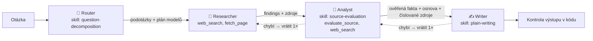

# Research Agents – multi-agentní výzkumný asistent

Uživatel zadá otázku a zpracují ji čtyři agenti s odlišnými rolemi. V UI je vidět, co který právě dělá,
jaké nástroje volá, co si předávají a jak vypadá přesné `messages`, system prompt a tools každého z nich.

**Živá verze:** _doplnit URL_ · **Bez API klíče** aplikace běží v mock režimu (stejný tvar odpovědí jako API,
orchestrace i tool loop běží naostro).



## Jak to splňuje zadání

| Požadavek | Kde |
|---|---|
| 3–4 subagenti s odlišnými rolemi | `app/agents.py`, system prompty v `prompts/*.md` |
| UI ukazuje práci každého agenta, ne jen shrnutí | karty agentů, živý průběh, inspektor (klik na kartu) |
| Claude API voláno napřímo, bez LangChainu | `app/llm.py` – `httpx` POST na `/v1/messages`, vlastní tool loop |
| Viditelná práce s messages, system prompt a tools | inspektor: záložky *System prompt*, *Messages* (přesné pole poslané do API), *Tools* |
| Vlastní Skill se SKILL.md, reálně použitý | `skills/source-evaluation` (Analyst, i jako tool `evaluate_source`), `skills/plain-writing` (Writer), `skills/question-decomposition` (Router) |
| Jasný handoff mezi agenty | `app/orchestrator.py` + kontrakty v `app/contracts.py`, v UI události 🤝 a ↩ |
| Agent s nástrojem, který opravdu volá | Researcher: `web_search` (server tool Anthropic) + `fetch_page` (náš klient); Analyst: `evaluate_source` + `web_search` |
| Orchestrace explicitně v kódu | sekvenční pipeline v `Pipeline.run()`, žádné předávání uvnitř jednoho promptu |

## Orchestrace a handoffy

`app/orchestrator.py` je jediné místo, které posouvá data mezi agenty. Agenti spolu nemluví napřímo.

1. **Router** (vždy nejlevnější model) určí náročnost `simple | moderate | complex`, cíl a 2–5 podotázek.
   Podle náročnosti **kód** (tabulka `MODEL_PLAN` v `app/agents.py`) vybere model a rozpočet vyhledávání
   pro další agenty:

   | náročnost | Researcher | Analyst | Writer | web_search |
   |---|---|---|---|---|
   | simple | Haiku | Haiku | Haiku | 3 |
   | moderate | Sonnet | Sonnet | Sonnet | 5 |
   | complex | Sonnet | Opus | Opus | 8 |

2. **Researcher** hledá (`web_search`), čte stránky (`fetch_page`) a vrací `findings` se zdroji.
3. **Analyst** ohodnotí každý zdroj skillem `source-evaluation`, ověří klíčová tvrzení a připraví osnovu.
4. **Writer** napíše odpověď skillem `plain-writing` a cituje číslované zdroje `[n]`.
5. **Kontrola výstupu** v kódu: každá citace míří na existující zdroj, delší odstavce mají citaci,
   je tam sekce „Co nevíme“.

Každý handoff má dvě kontroly:

- **kontrakt v kódu** (`app/contracts.py`), např. Researcher musí dodat ≥ 3 zjištění a ≥ 2 různé zdroje,
- **kontrolu přijímajícího agenta**: Analyst i Writer vracejí `handoff_check: {ok, missing}`.

Když jedna z nich neprojde, orchestrátor vrátí práci předchozímu agentovi se seznamem, co chybí
(`MAX_RETURNS`, výchozí 1×). V UI je to vidět jako ↩ a v logu.

## Skills

Skill = složka se `SKILL.md` (YAML frontmatter `name`, `description`, `version` + instrukce) a volitelnými skripty.
`app/skills.py` je načte a připojí do system promptu agenta jako `<skill>` blok. Skript skillu je agentovi
vystavený jako nástroj, takže skill se opravdu volá, ne jen „čte“.

- **`source-evaluation`** (Analyst): dvoufázové hodnocení. Nejdřív skript `scripts/score_source.py`
  (přes tool `evaluate_source`) dá deterministické skóre 0–100 a tier A–D podle typu domény, https a stáří.
  Agent ho smí upravit nejvýš o ±15 s odůvodněním. Pak podle pravidel přidělí každému faktu jistotu
  (`high` jen s jedním primárním A zdrojem nebo dvěma nezávislými B+). Tier se zobrazuje u zdrojů v odpovědi.
- **`plain-writing`** (Writer): odpověď nejdřív, krátké věty, čísla s jednotkou a datem, citace u každého
  faktu, oddělení faktů od odhadů, povinná sekce „Co nevíme“, zakázané vatové fráze, délka podle náročnosti.
- **`question-decomposition`** (Router): jak se ptá konzultant, než odpoví: jaké rozhodnutí uživatel dělá,
  co se dá změřit, jaké podotázky pokrýt.

Skript lze pustit i ručně: `python skills/source-evaluation/scripts/score_source.py https://www.czso.cz "2026"`.

## Viditelnost messages, system promptu a tools

Klikni na kartu agenta. Inspektor ukazuje:

- **System prompt**: role + připojené skills, přesně jak šly do API,
- **Messages**: přesné pole `messages` včetně `tool_use`, `tool_result`, `server_tool_use` a `web_search_tool_result`,
- **Tools**: JSON definice nástrojů a každé volání se vstupem a výsledkem,
- **Výstup** a **Handoff in**: co agent vrátil a co dostal, včetně výsledku kontraktu,
- **Skill**: celý SKILL.md.

Každý běh se loguje do `logs/<run_id>.jsonl` a stáhne se z UI („Stáhnout log“).

## Spuštění

```bash
python -m venv .venv && . .venv/bin/activate
pip install -r requirements.txt
cp .env.example .env            # bez ANTHROPIC_API_KEY běží mock režim
set -a; . ./.env; set +a
uvicorn app.main:app --reload --port 8000
# http://localhost:8000
pytest -q                       # 7 testů, běží offline
```

Docker: `docker build -t research-agents . && docker run -p 8000:8000 --env-file .env research-agents`

Nasazení na server: `deploy/research-agents.service` (systemd) a `deploy/Caddyfile.snippet`
(`flush_interval -1`, aby SSE události šly hned).

## Bezpečnost a náklady

- Klíč jen v prostředí (`.env` / `/etc/research-agents.env`), nikdy v repu.
- Volitelný `ACCESS_CODE` pro veřejné demo, limit `RUNS_PER_HOUR` na IP, otázka max. 500 znaků.
- `fetch_page` odmítá privátní a lokální adresy, stahuje max. 2 MB a vrací max. 6000 znaků textu.
- Rozpočet vyhledávání (`max_uses`) a model podle náročnosti drží cenu jednoduchých dotazů nízko.

## Jak jsem pracoval s AI

Aplikaci jsem stavěl s Claude jako kódovacím agentem. Já jsem určil architekturu (sekvenční pipeline
s kontrolovanými handoffy, router na výběr modelu, skills jako instrukce i nástroj), pravidla skills
a kontrakty, a ověřoval jsem výsledek testy a během v mock režimu. Claude psal většinu kódu.

## Co by bylo dál

- Paralelní Researcher pro každou podotázku (fan-out) se sloučením před Analystem.
- Evaluace: sada otázek s očekávanými zdroji a měření, kolik citací drží.
- Cache `fetch_page` a výsledků hledání mezi běhy.
